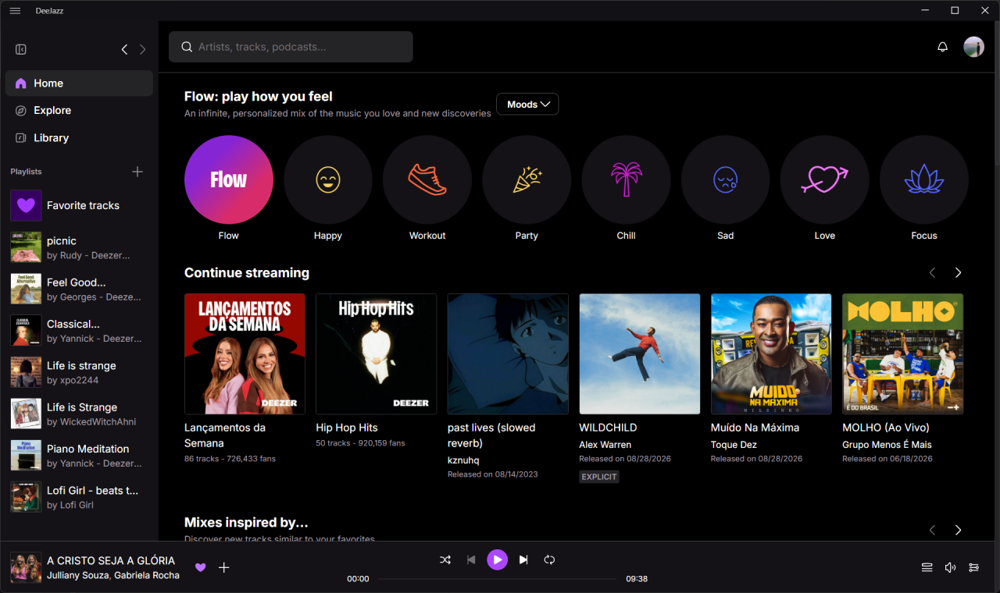
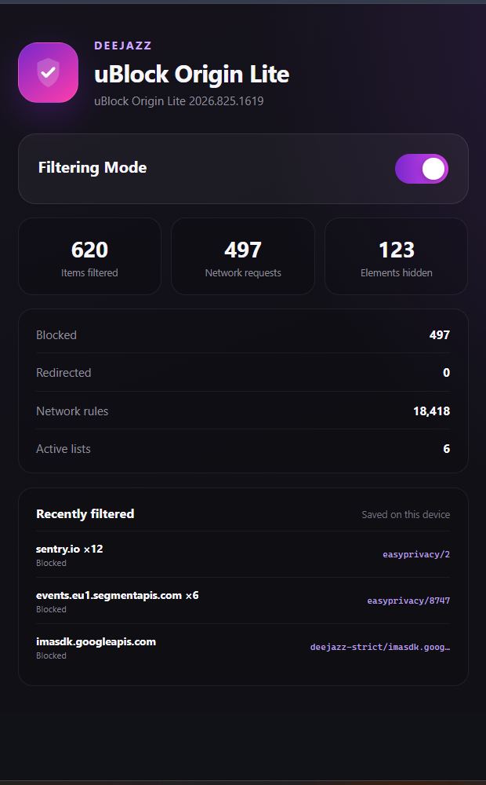

# DeeJazz

## Integrated with uBlock Origin Lite

DeeJazz is a music player for Windows, Linux and Android. It combines a focused listening experience with built-in uBlock Origin Lite filtering, DeeJazz cosmetic rules, media controls, system tray support on desktop, and a localized blocker dashboard.



## Highlights

- Built-in uBlock Origin Lite with 71 interface languages
- Network and cosmetic filtering enabled at application startup
- Dedicated blocker dashboard with persistent filtering history
- Windows x64 installer
- Portable Linux builds for AMD64 and ARM64
- Android APK with DeeJazz name, icons, artwork and verified startup updates
- Automatic startup updates from verified GitHub Release packages
- Linux MPRIS media controls, tray integration, and Wayland support

## Built-in protection

The localized uBlock Origin Lite dashboard shows active filtering, persistent counters, enabled lists, and recently filtered requests.



## Download

Download the latest Windows, Linux and Android packages from [GitHub Releases](https://github.com/ryahconstantino/deejazz/releases/latest).

| Platform | Package |
| --- | --- |
| Windows x64 | `deejazz-windows-x64-<version>.exe` installer |
| Linux AMD64 | `deejazz-linux-amd64-<version>.tar.gz` portable build |
| Linux ARM64 | `deejazz-linux-arm64-<version>.tar.gz` portable build |
| Android | `deejazz-android-<version>.apk` signed APK |

On startup, DeeJazz checks the latest stable GitHub Release. Windows and Linux
download the matching package, verify its GitHub SHA-256 digest, install it and
restart automatically. Android performs the same verified download and opens
the protected system installer; Android requires the user to approve the app as
an installation source and confirm the update.

Linux users can install the latest compatible package without `sudo`:

```bash
curl -fsSL https://raw.githubusercontent.com/ryahconstantino/deejazz/master/scripts/install-linux.sh | sh
```

### Android

The Android build ships as a signed APK, so it installs outside Google Play:

1. Download `deejazz-android-<version>.apk` from [GitHub Releases](https://github.com/ryahconstantino/deejazz/releases/latest) on the device.
2. Allow the browser or file manager to install unknown apps when Android asks.
3. Open the downloaded APK and confirm the installation.
4. Keep the app as an allowed installation source so startup updates can install new versions.

Android requires version 6.0 (API 23) or newer; Android 8.0 and later asks for
the per-app "install unknown apps" permission. Startup updates are verified
against the GitHub SHA-256 digest before the system installer opens.

## Build from source

Desktop runtime files live in `desktop/`. The decoded Android project lives in
`android/app/`; see [Android build and signing instructions](android/README.md).
Android contains editable resources and Smali, not the original Java/Kotlin
source. DeeJazz-specific branding, package metadata, Search genre colors and
the verified startup updater are maintained in this decoded project.

Install Node.js, npm, Git, and Git LFS. Then clone the repository and install its dependencies:

```bash
git clone git@github.com:ryahconstantino/deejazz.git
cd deejazz
git lfs pull
npm install
```

The release version is defined by `DEEJAZZ_VERSION` in `.env.build`. Synchronize the metadata and apply the DeeJazz integration with:

```bash
npm run version:sync
npm run app:integrate
```

Build the Windows x64 installer:

```bash
npm run dist:win
```

Build the portable Linux packages:

```bash
npm run dist:linux
npm run dist:linux:arm64
```

Generated files are written to `dist/`:

- `deejazz-windows-x64-<version>.exe`
- `deejazz-linux-amd64-<version>.tar.gz`
- `deejazz-linux-arm64-<version>.tar.gz`
- `deejazz-android-<version>.apk`

Build the signed Android APK (see [android/README.md](android/README.md) for the required SDK and signing secrets):

```bash
npm run dist:android
```

Filenames use the release version from `DEEJAZZ_VERSION` (or `.env.build` for
local builds).
The Linux installer resolves the latest version automatically and also supports
older releases with unversioned filenames.

## Linux external links

DeeJazz opens web links through `DZ_BROWSER`, `BROWSER`, `xdg-open`, `gio open`
and the first installed browser, in that order. The fallbacks keep links
working on minimal Arch/XFCE installs where `xdg-utils` is absent or replaced
by a broken handler. If links open in the wrong browser, launch DeeJazz with an
explicit choice:

```bash
BROWSER=firefox deejazz
```

Set `DZ_KEEP_GDK_BACKEND=1` to preserve a custom `GDK_BACKEND` value for the
browser process. The installer also registers the `deejazz://`, `deezer://`
and `dzr://` URL schemes so deep links reach DeeJazz on XFCE, where
`xdg-settings` does not support scheme handlers.

## Automated releases

GitHub Actions builds the Windows x64 installer, both Linux packages and the
signed Android APK, then publishes them to a GitHub Release. All release
packages are written to `dist/`. Configure the Android
signing secrets described in [android/README.md](android/README.md). On every
push to `master`, the workflow reads the version from `package.json`. If that
version does not have a GitHub Release yet, the workflow builds all packages,
creates its `v`-prefixed tag and publishes the release. If it already exists,
the build jobs are skipped.

A release is published by pushing `master`, never by pushing a tag: the workflow
creates the `v`-prefixed tag itself. Pushing a tag alongside `master` starts a
second run for the same version, which fails when it tries to publish an
existing release.

You can also run **Build and publish release** manually from the Actions tab and provide the version to publish. The workflow only allows the four versioned packages listed above and in the Android instructions; additional files, including `.sha256` files, are rejected before publication.

## License

DeeJazz is released under the [MIT License](LICENSE).

## Website

The DeeJazz website is published from the root of the [`pages`](https://github.com/ryahconstantino/deejazz/tree/pages) branch.
